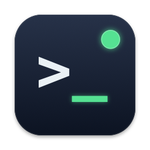
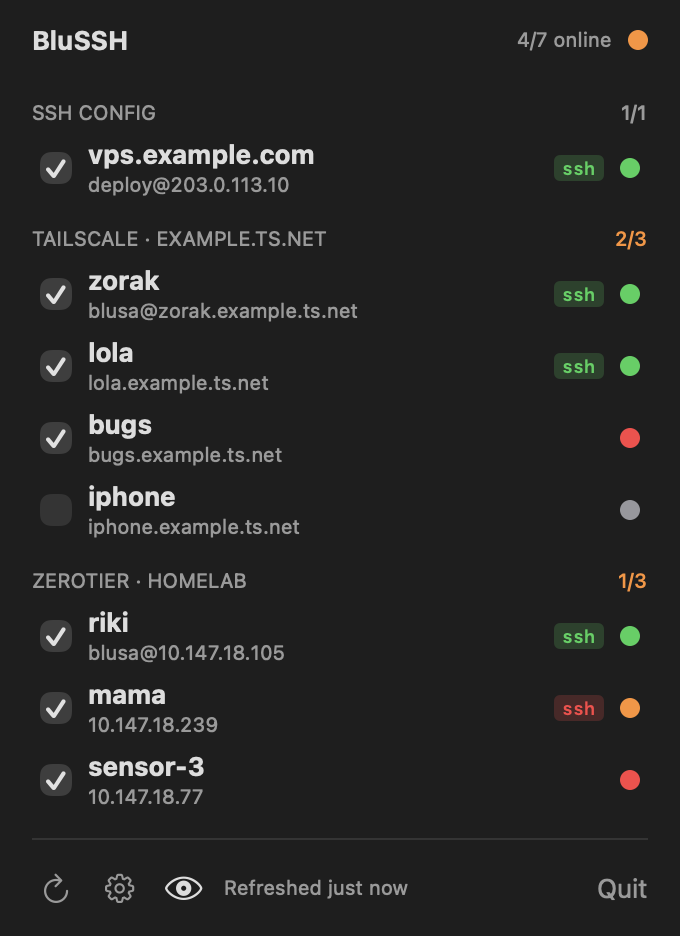
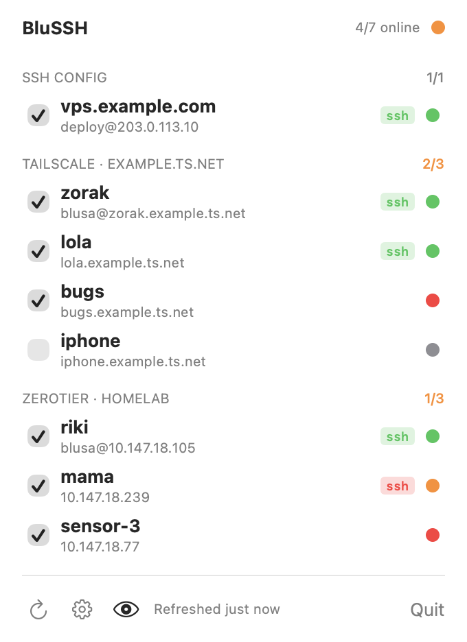
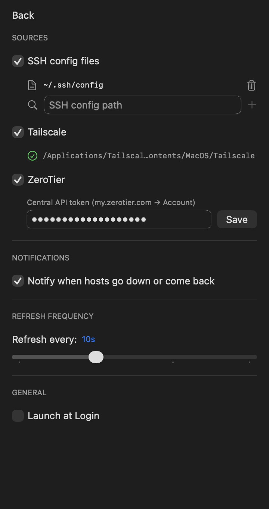

<p align="center">
  
</p>

# blussh

Host connectivity monitor for your menu bar / status bar. Hosts are discovered
automatically from your **SSH config**, **Tailscale** tailnet, and **ZeroTier**
networks; blussh shows live status and notifies when a host goes down or comes
back up.

It comes in two native versions sharing the same behavior
([`docs/monitoring-spec.md`](docs/monitoring-spec.md)):

| | Where | Built with |
|---|---|---|
| **macOS** | menu bar app | SwiftUI — [`macos/`](macos/) |
| **Omarchy** (Arch + Hyprland) | Omarchy shell bar widget | Quickshell QML + a Python backend — [`omarchy/`](omarchy/) |

| Popover (dark) | Popover (light) | Settings |
|---|---|---|
|  |  |  |

## Features

- **Three host sources**, each toggleable: ssh config files (Stow-friendly
  symlink resolution), `tailscale status --json`, and ZeroTier (local service
  API for joined networks + Central API for member names).
- **Two liveness signals**: what the VPN control plane reports (`netOnline`)
  and a TCP port-22 probe (`sshOnline`) for hosts that run SSH. SSH servers are
  auto-detected with a one-time probe; override per host.
- **Cross-source merge**: an ssh-config entry pointing at a VPN host's IP or
  DNS name merges into it, so copying yields `ssh user@alias`.
- **Debounced notifications**: a state flip must repeat on 2 consecutive checks
  before notifying — no alerts from a single dropped probe.
- Groups with online counters, hide hosts you don't care about, click to copy
  the ssh command, and `HOSTNAME ●` with an aggregate status dot in the bar.

## Install

### macOS

```bash
brew install blusa/tap/blussh
```

Requires macOS 15.3+. The app is signed and notarized; the cask also clears
`com.apple.quarantine` so launch-at-login works. Build and release details:
[`macos/README.md`](macos/README.md).

### Omarchy

Requires Omarchy 4 (the Quickshell-based Omarchy shell). Python 3, `jq` and
`wl-copy` ship with Omarchy; Tailscale and ZeroTier are optional.

```bash
git clone https://github.com/blusa/blussh.git
cd blussh
omarchy/install.sh
```

The installer validates the plugin, copies it to
`~/.config/omarchy/plugins/blusa.blussh`, adds it to the right side of the bar
and links the `blussh` CLI into `~/.local/bin`. To update, `git pull` and run
it again. To remove it: `omarchy plugin remove blusa.blussh`.

Open the widget and press `,` (or the gear) to add ssh config files and set up
ZeroTier. Usage, keyboard shortcuts and ZeroTier setup:
[`omarchy/README.md`](omarchy/README.md).

## Repository layout

```
macos/     SwiftUI app, Xcode project, release scripts (Homebrew cask)
omarchy/   Omarchy shell plugin: manifest, QML UI, blussh.py engine, tests
docs/      shared functional spec, design notes, screenshots
```

## Docs

- [`docs/monitoring-spec.md`](docs/monitoring-spec.md) — platform-agnostic
  functional spec: every external interface (verified JSON shapes) and the
  algorithms (merge, liveness, debounce) both versions implement.
- [`docs/superpowers/specs/2026-09-02-vpn-discovery-design.md`](docs/superpowers/specs/2026-09-02-vpn-discovery-design.md)
  — design decisions behind the VPN discovery feature.

The screenshots above are rendered from the real SwiftUI views with demo data
(no personal network info) — see the harness approach in `CLAUDE.md`.
